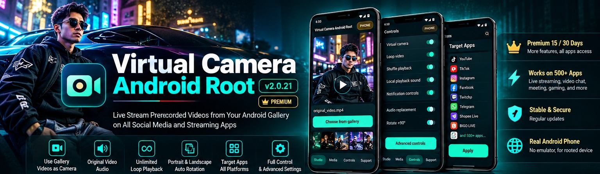
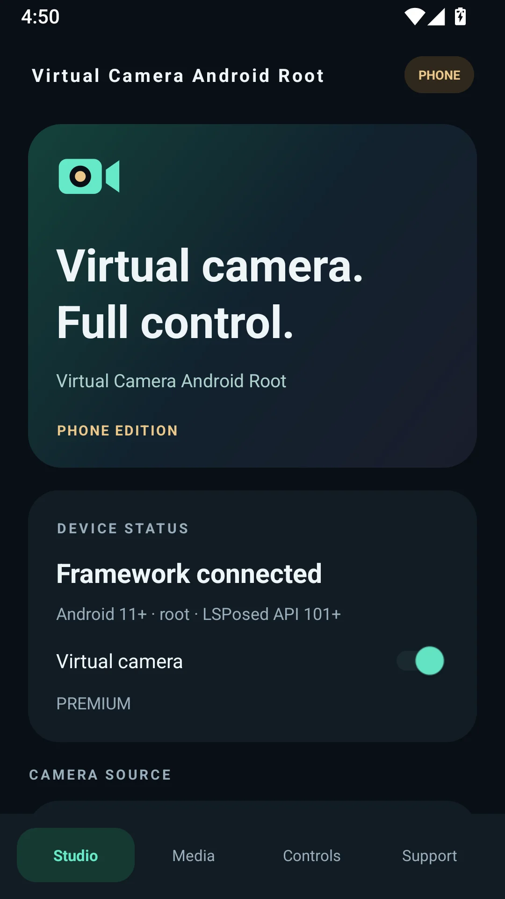
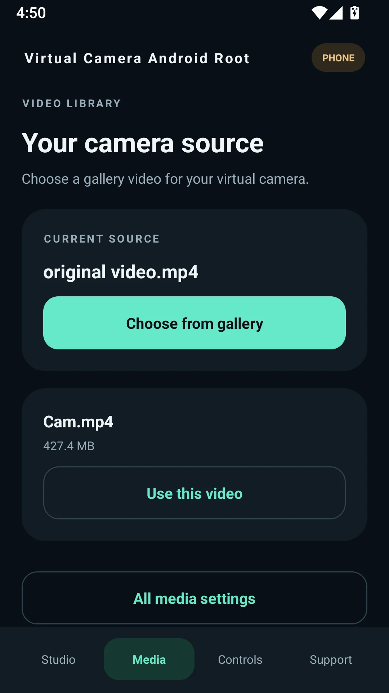
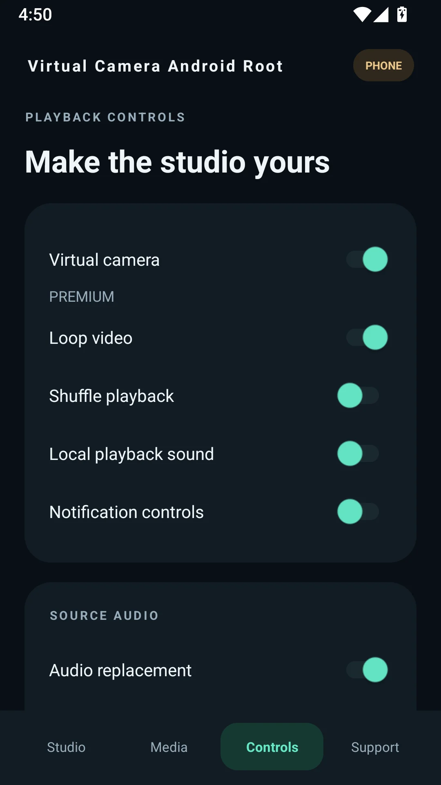
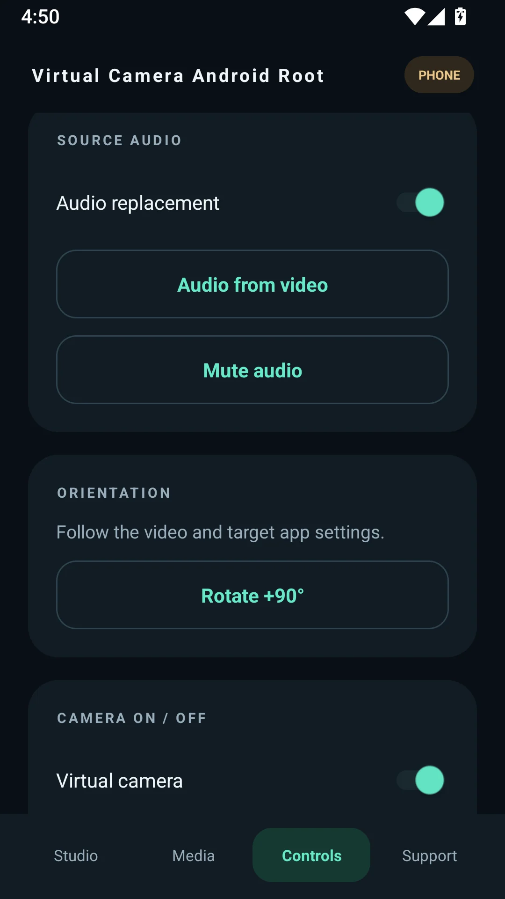
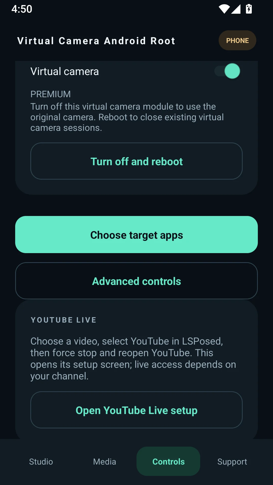

# Virtual Camera Android Root

### The Android Virtual Camera APK That Turns Your Gallery Into a Live Streaming Studio

**Live stream prerecorded gallery videos as camera input. Keep your original video audio, take control of playback, and build a professional mobile streaming workflow—right on your rooted Android phone.**

**Android 11+** · **API 30, 31, 33, 34, 35, 36, 37** · **LSPosed API 101+** · **3 ABI Downloads**

  

**500+ Android apps tested by the developer** • **Real Android smartphones** • **Root & LSPosed**

---

## 🚀 Live Stream Prerecorded Videos From Your Android Gallery

**Virtual Camera Android Root** is a feature-rich **Android virtual camera APK** built for users who want to **replace Android camera input with a video from the gallery**. Select an MP4 or another supported media file, enable your virtual camera configuration, and present the video as camera input in supported social media, live streaming, and video communication applications.

Stop pointing your camera at a second monitor: **make your Android video gallery your virtual camera source**. With original source-audio options, microphone controls, video looping, portrait and landscape support, and a target-app selector, your content stays ready for demonstrations, streaming, live shopping and presentations.

**Developer testing covers more than 500 Android applications** across streaming, social networks, video calls, communication and creator workflows. App behavior depends on its actual camera and audio interfaces; the app does not grant platform live-streaming eligibility.

### 🎯 Why creators choose Virtual Camera Android Root

- **Live stream a video from your Android gallery** instead of using your front or rear camera.
- **Use prerecorded MP4 video as virtual Android camera input** for repeatable presentations and live content.
- **Route the original audio from your video** and control unwanted microphone capture.
- **Loop gallery video playback** and manage shuffle and local playback settings.
- **Optimize vertical and horizontal output** for different social-media layouts.
- **Choose target apps** using LSPosed and advanced device controls.

## ✨ Key Features: A Complete Virtual Camera Studio on Android

| Feature | What you get |
|---|---|
| **Gallery video as camera** | Choose video clips from Android storage and send supported video frames through a virtual camera pipeline. |
| **Original soundtrack routing** | Stream with audio sourced from your selected video, including source audio replacement and microphone mute controls. |
| **Continuous video loops** | Repeat prerecorded content for long sessions, with shuffle options and media playback controls. |
| **Portrait / landscape video** | Control orientation and 9:16 / 16:9 aspect ratios to keep output framed appropriately. |
| **Advanced Android camera control** | Control virtual camera status, target apps, audio replacement and device-side module behavior. |
| **Root + LSPosed integration** | Dedicated PHONE edition for real rooted Android smartphones with LSPosed API 101+. |
| **Target application selection** | Apply the virtual camera to selected Android applications rather than every app indiscriminately. |
| **Free and Premium options** | Premium controls are license managed; updating the installed app does not reset the subscription expiration date. |

## 📱 Real App Screenshots

These are screenshots of the Virtual Camera Android Root PHONE interface: Studio, Media, Controls, audio routing, and target-app/advanced settings.

  
  
  
  
  

### 🔎 Explore the Full Live Streaming & Video Chat App Directory

The developer reports testing Virtual Camera Android Root with **500+ Android applications**. The expanded developer-supplied directory contains **717 distinct names**, spanning live streaming, social media, creator platforms, video chat, and dating/social discovery. Duplicate entries were consolidated while preserving the original app names.

**[📚 FULL APP DIRECTORY ON GITHUB](SUPPORTED_APPS.md)** · **[🔍 SEARCH ALL APPS ON THE WEBSITE](https://hellowisnu12.github.io/Virtual-Camera-Android-Root/supported-apps.html)** · **[⬇️ DOWNLOAD THE ANDROID APK](https://github.com/hellowisnu12/Virtual-Camera-Android-Root/releases)**

Popular entries include **TikTok LIVE, YouTube Live, Instagram Live, Facebook Live, Twitch, WhatsApp, Shopee Live, BIGO LIVE, VK Live, REDnote, Poppo Live, Tango Live, LiveMe, Chamet, Yubo, Tinder, Bumble and OmeTV**.

> App names reflect the developer-supplied list. An appearance in the directory does not independently establish current store availability, platform endorsement, or identical capabilities in every version of every app.

## 🌍 500+ App Testing Coverage: Streaming, Social Media and Video Calls

**One Android virtual camera, hundreds of potential workflows.** According to the developer's testing, the app has been exercised with **500+ Android applications**, including well-known platforms and creator tools. Representative ecosystems include:

- **Live streaming:** TikTok LIVE, YouTube Live, Instagram Live, Facebook Live, Twitch, Kick, VK Live, BIGO LIVE, Shopee Live, Nimo TV, Rumble, Twitcast, YouNow, X Live, Tango Live, Likee, MICO, Poppo Live.
- **Social and messaging:** WhatsApp, Telegram, Discord, Facebook, Instagram, TikTok, REDnote, LINE, WeChat, Vero.
- **Video calls and meetings:** Zoom, Google Meet, Microsoft Teams, Webex, OmeTV, Azar, Chamet, LivU.
- **Creator and e-commerce:** PRISM Live Studio, Streamlabs, Shopee Live, content demos, virtual presentations and live selling.

### 🎬 Live stream on TikTok, Instagram, YouTube and beyond

Looking for **virtual camera Android for TikTok LIVE**, **live stream prerecorded video on Instagram**, **use an MP4 as camera input on YouTube Live**, or **Android virtual camera for Facebook Live**? Virtual Camera Android Root puts gallery-video selection, camera routing and playback controls in one place for supported app-camera workflows.

> Independent application; not affiliated with or endorsed by the listed third-party platforms. Users must follow their streaming rules and any prerecorded-content disclosure requirements.

## ⚙️ Android & LSPosed Requirements

| Component | Requirement |
|---|---|
| Device | **Physical Android smartphone with root** (PHONE edition) |
| Android version | **Android 11 and newer** |
| Android API levels | **30, 31, 33, 34, 35, 36, 37** |
| LSPosed | **Minimum LSPosed API 101** |
| APK architectures | **arm64-v8a**, **armeabi-v7a**, **x86_64** |
| Source video | Compatible locally stored gallery video |

## ⬇️ Download Virtual Camera Android Root APK

Choose the APK that matches your Android device's CPU architecture. Download directly from the **official GitHub Releases page**—never from an unknown repackaging website.

| Build | Best for | Download |
|---|---|---|
| **arm64-v8a** | Modern 64-bit Android phones (recommended) | **[⬇️ Choose ARM64 APK](https://github.com/hellowisnu12/Virtual-Camera-Android-Root/releases)** |
| **armeabi-v7a** | Compatible 32-bit ARM devices | **[⬇️ Choose ARM32 APK](https://github.com/hellowisnu12/Virtual-Camera-Android-Root/releases)** |
| **x86_64** | Compatible Android x86_64 devices | **[⬇️ Choose x86_64 APK](https://github.com/hellowisnu12/Virtual-Camera-Android-Root/releases)** |

**[🚀 DOWNLOAD THE LATEST PUBLISHED APK NOW](https://github.com/hellowisnu12/Virtual-Camera-Android-Root/releases)**

The **[official website](https://hellowisnu12.github.io/Virtual-Camera-Android-Root/)** automatically looks up the newest published GitHub release and links each architecture button to the corresponding APK asset. That avoids sending visitors to a future version that has not yet been uploaded.

## 📖 How to Use a Gallery Video as Your Android Camera

1. **Install the correct APK** for your Android device architecture.
2. **Enable Root and LSPosed** (minimum API 101) and configure the Virtual Camera Android Root module.
3. **Choose a gallery video** on the Media screen.
4. **Set up audio**, video loop, microphone, orientation and other controls.
5. **Choose target applications** in your Android/LSPosed configuration.
6. **Open your streaming or video app** and test the virtual camera feed before going live.

## 🔥 Android Virtual Camera FAQs

### How do I live stream prerecorded videos from my Android gallery?

Install Virtual Camera Android Root on a compatible rooted Android phone, choose a gallery video, configure LSPosed and select your target application. Supported camera requests can use the selected gallery video as the virtual source.

### Can I use an MP4 video instead of my Android phone camera?

Yes, that is the primary purpose of Virtual Camera Android Root: use your prerecorded gallery media as the virtual camera input in compatible applications.

### Can I stream the audio embedded in my video?

The app includes source-audio routing and microphone control, designed to carry your selected video's soundtrack with the virtual camera workflow.

### Does this Android virtual camera require Root or LSPosed?

**Yes.** The PHONE edition is designed for rooted Android phones and requires **LSPosed API 101 or newer**.

### Which Android versions are supported?

The developer specifies **Android 11+**, with Android API levels **30, 31, 33, 34, 35, 36 and 37**.

### Does an APK update reset my Premium subscription?

The product's license design maintains subscription expiration independently of app updates. Install an update over the existing app with the matching package and signing identity; do not uninstall your existing app before updating.

## ⭐ Ready to Put Your Video Gallery on Camera?

**Stream prepared content. Control the camera source. Take your mobile video workflow further.**

[**⬇️ DOWNLOAD VIRTUAL CAMERA ANDROID ROOT**](https://github.com/hellowisnu12/Virtual-Camera-Android-Root/releases) · [**🌐 OFFICIAL WEBSITE**](https://hellowisnu12.github.io/Virtual-Camera-Android-Root/)

<strong>Popular long-tail search topics</strong>

Virtual camera Android root APK, Android virtual camera for live streaming, how to live stream gallery video on Android, Android gallery video as camera, replace Android camera with MP4, LSPosed virtual camera module Android 11, Android root camera replacement with original audio, virtual camera TikTok LIVE Android, virtual camera Instagram Live Android, prerecorded video live streaming from Android gallery, Android virtual camera with microphone mute, loop gallery video as camera, live streaming virtual camera for rooted phones, Virtual Camera Android Root arm64-v8a APK.

*Virtual Camera Android Root is a proprietary application. This public repository provides product information, screenshots, and APK distribution—not its private camera-routing or licensing source code.*
