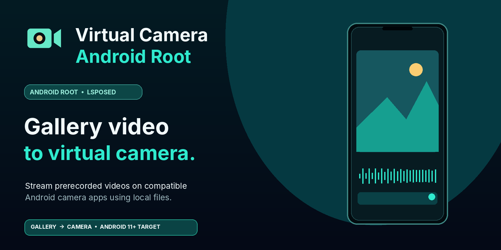
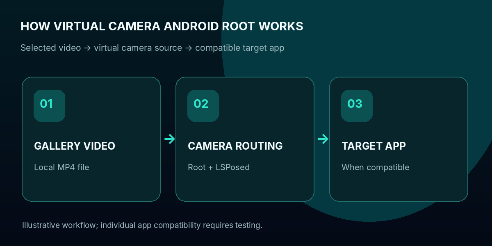
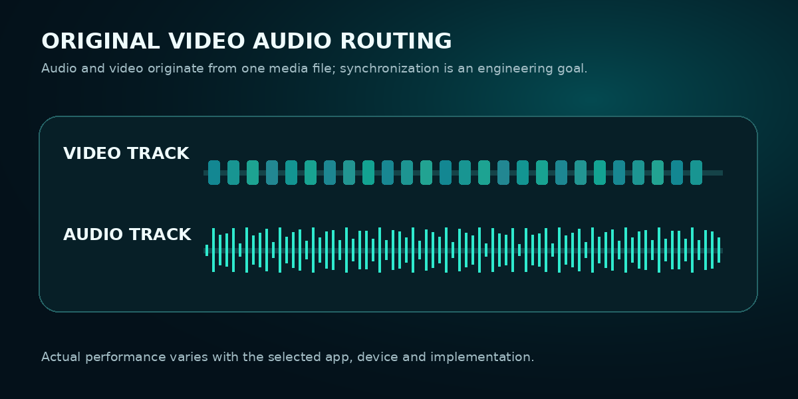
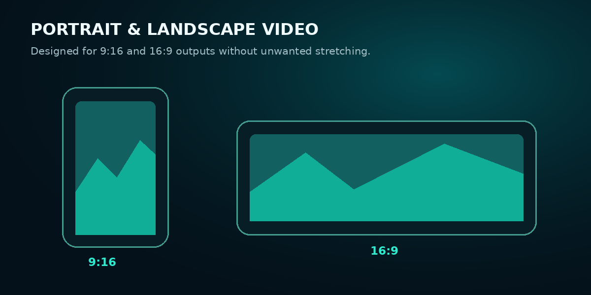
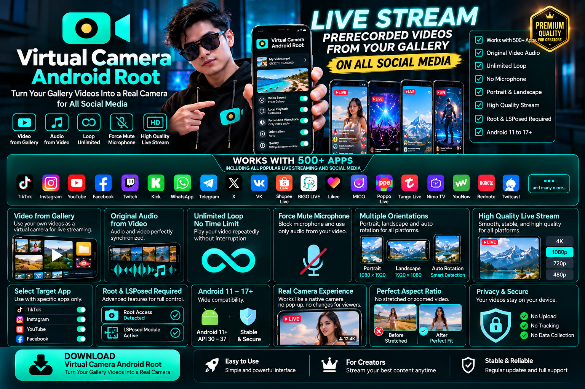
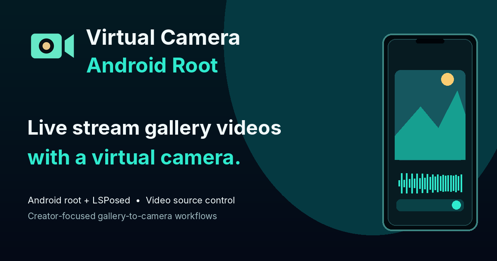

<div align="center">


# Virtual Camera Android Root

### Live Stream Gallery Videos as a Virtual Camera on Rooted Android

**Turn your existing video library into a flexible camera source for compatible Android applications.**

**Version 2.0.20** · **Three Android ABI builds** · **Root + LSPosed** · **Physical Android device focus**

[Explore Features](#key-features-of-virtual-camera-android-root) · [How It Works](#how-to-use-virtual-camera-android-root-on-rooted-android) · [Compatibility](#social-media-and-live-streaming-app-compatibility) · [Download](#download-virtual-camera-android-root-apk)

</div>



> **Important:** This public GitHub repository is a **promotional showcase and APK release landing page**, not the complete production source code. Camera hooks, private audio synchronization logic, license/server systems, and other proprietary implementations are **not included**. Promotional visuals are concept illustrations, not proof of support for every app.

## What Is Virtual Camera Android Root?

**Virtual Camera Android Root** is an Android virtual camera utility designed for **live streaming prerecorded videos from the gallery instead of recording with the physical front or rear camera**. On compatible **rooted Android smartphones**, it aims to route a selected video file into camera interfaces used by supported live streaming, social media, and video communication applications.

If you've searched for **how to live stream a gallery video on Android**, **how to use an MP4 file as a phone camera**, or an **LSPosed virtual camera module for a rooted Android device**, Virtual Camera Android Root is built around exactly that workflow.

Rather than pointing your device at another screen, use the video stored locally on your phone as the *intended* source. Control playback, explore routing of the original video's audio, manage portrait and landscape orientation, and select target apps from one specialized interface.

### Designed for Creators, Testers, and Power Users

- **Content creators:** present prepared videos, product demonstrations, tutorials, and recorded material in compatible live-camera workflows.
- **Developers and testers:** experiment with repeatable camera input when testing supported apps on rooted Android devices.
- **Android enthusiasts:** customize camera routing with root and LSPosed instead of relying exclusively on physical sensor output.

## Key Features of Virtual Camera Android Root

| Feature | What it means |
|:--|:--|
| **Gallery video as camera input** | Select a compatible prerecorded video and use it as the intended video source for supported Android camera requests. |
| **Virtual front/rear camera routing** | Root + LSPosed integration is designed to redirect supported camera flows toward your chosen video. |
| **Original video audio** | Audio routing is designed around the soundtrack embedded in the source file, with audio/video synchronization a central goal. |
| **Microphone management** | Intended controls for reducing or muting microphone input where routing is supported, so outside audio does not unintentionally mix with prerecorded sound. |
| **Repeat / loop playback** | Playback looping is designed for reusing a selected video in longer sessions. Actual reliability depends on device, duration, and app. |
| **Portrait and landscape** | Orientation handling targets both **9:16** and **16:9** media to reduce stretching and wrong rotation. |
| **Target application selection** | Choose which compatible installed apps should use the virtual camera integration. |
| **Rooted physical Android** | Built for smartphones with root/LSPosed, targeting **Android 11 and newer**, not primarily Android emulators. |



### Live Stream Video From Your Gallery Instead of a Camera

Virtual Camera Android Root's core idea is direct: choose a locally stored video, set the playback options, and present it as a virtual camera feed **where the target Android application and device support that path**. This is useful for users searching for *gallery video to live camera Android*, *prerecorded video for live streaming*, or *replace Android front camera with MP4 video*.

### Original Soundtrack and Audio/Video Sync

When a video includes sound, a virtual camera project must account for both video frames and audio capture. Virtual Camera Android Root is designed to source the soundtrack from the selected media file, rather than accidentally publishing surrounding microphone sound. Precise sync and mic isolation **must be verified on each supported target application**; they are not guaranteed across all Android apps.



### Portrait, Landscape, and Aspect Ratio Controls

Vertical social streaming and horizontal video playback have different resolution, rotation, and cropping requirements. Virtual Camera Android Root's design targets **9:16 portrait** and **16:9 landscape** workflows, with orientation controls intended to prevent stretched or elongated streams.



## Social Media and Live Streaming App Compatibility

Virtual Camera Android Root aims to integrate with common camera-based workflows on social media and communication platforms. The **target ecosystem for development and testing** includes **TikTok / TikTok LIVE, Instagram / Instagram Live, YouTube / YouTube Live, Facebook / Facebook Live, Twitch, Kick, WhatsApp, Telegram, VK Live, BIGO LIVE, Shopee Live, Likee, Tango Live, MICO, Poppo Live, and other Android apps**.

**These names indicate development targets, not certified compatibility.** Each app can use different Camera1, Camera2, CameraX, WebRTC, audio capture, security, and server-side streaming paths. Some app features may reject a virtual feed or require broadcaster eligibility. Virtual Camera Android Root does not grant streaming permissions or bypass platform policies.

## How to Use Virtual Camera Android Root on Rooted Android

1. **Prepare a compatible physical Android smartphone.** Confirm that the Android OS, root environment, and LSPosed build match the APK's actual requirements.
2. **Install the Virtual Camera Android Root APK from an official source.** Do not install repackaged or unauthorized builds.
3. **Enable the relevant LSPosed module/configuration.** Grant permissions only if you understand the consequences of root-level modifications.
4. **Choose a video from your Android gallery.** Use an appropriate file format, aspect ratio, and audio track.
5. **Adjust playback and routing settings.** Configure orientation, audio handling, looping, and a compatible target app.
6. **Test privately first.** Check frame timing, audio sync, orientation, and mic isolation in the exact target application before going live.

> **Prerecorded-content transparency:** Follow the rules of every streaming platform and disclose prerecorded material when required. Do not imply that a recording is live if that would mislead viewers or violate applicable platform policies.

## System Requirements

- **Device:** Physical Android smartphone with a supported architecture (often `arm64-v8a` on modern phones).
- **Operating system:** Android 11+ is the product's target range, subject to actual APK manifest and testing.
- **Android root:** Required for root-powered camera integrations.
- **LSPosed:** Required for supported module integrations.
- **Video files:** Locally stored files supported by the chosen Virtual Camera Android Root build.
- **Third-party platforms:** Compatibility varies and must be tested per platform, app version, and phone.

## Frequently Asked Questions

### Can I live stream a prerecorded gallery video on Android?

Virtual Camera Android Root is specifically designed around using a selected video as virtual camera input on a rooted Android phone. Whether it works in any particular live-streaming app depends on that app's camera/audio implementation, permissions, and platform restrictions.

### Can I use an MP4 video as my Android camera?

That is a key intended workflow: selecting a compatible file and routing the video through a virtual camera integration for supported apps.

### Does Virtual Camera Android Root work with TikTok LIVE, Instagram Live, and YouTube Live?

These are development targets, **not universal compatibility guarantees**. Confirm your specific app versions and devices, and check platform eligibility for live broadcasting.

### Does Virtual Camera Android Root replace the Android microphone with the video's audio?

Virtual Camera Android Root is designed to manage source-video audio and microphone routing in supported configurations. Actual mic muting and A/V sync must be verified in each target app.

### Does Virtual Camera Android Root work without root or LSPosed?

Root and LSPosed are expected for the advanced camera-routing workflows described here; this project is **not primarily a non-root Android virtual camera**.

### Is this repository the complete Virtual Camera Android Root source code?

No. This is a promotional/marketing repository. It does not distribute proprietary Virtual Camera Android Root core implementation, premium licensing code, or production camera and audio hooks.

## Download Virtual Camera Android Root APK

**Version 2.0.20 — GitHub Releases.** Choose the APK that matches your device processor architecture. The app is intended for appropriately configured rooted Android devices with LSPosed; availability and compatibility depend on the actual APK build and device.

| APK build | Recommended hardware | Direct download |
|:---|:---|:---|
| **ARM 64-bit (`arm64-v8a`)** | Most modern ARM-based Android phones | [Download arm64-v8a APK](https://github.com/hellowisnu12/Virtual-Camera-Android-Root/releases/download/v2.0.20/VCAR-2.0.20-protected-arm64-v8a.apk) |
| **ARM 32-bit (`armeabi-v7a`)** | Older or compatible 32-bit ARM devices | [Download armeabi-v7a APK](https://github.com/hellowisnu12/Virtual-Camera-Android-Root/releases/download/v2.0.20/VCAR-2.0.20-protected-armeabi-v7a.apk) |
| **x86 64-bit (`x86_64`)** | Android devices/installations using an x86_64 processor | [Download x86_64 APK](https://github.com/hellowisnu12/Virtual-Camera-Android-Root/releases/download/v2.0.20/VCAR-2.0.20-protected-x86_64.apk) |

**[View official release v2.0.20](https://github.com/hellowisnu12/Virtual-Camera-Android-Root/releases/tag/v2.0.20)** · **[Visit the GitHub repository](https://github.com/hellowisnu12/Virtual-Camera-Android-Root)** · **[Open the promotional website](https://hellowisnu12.github.io/Virtual-Camera-Android-Root/)**

> **Download status:** The links above are release URL templates using your requested GitHub repository, tag and screenshot filenames. They will return an error until you **publish GitHub Release `v2.0.20` and upload the exact `.apk` filenames** shown below. No APK binaries are included in this marketing kit.

**Exact GitHub Release asset filenames:**

```text
VCAR-2.0.20-protected-arm64-v8a.apk
VCAR-2.0.20-protected-armeabi-v7a.apk
VCAR-2.0.20-protected-x86_64.apk
```

GitHub's download filenames use **`VCAR` only because that is the existing binary filename** shown in your screenshot. The product branding everywhere else is **Virtual Camera Android Root**. On Windows, `.apk` file extensions may be hidden in File Explorer; verify the actual file names before release.

**About builds:** `arm64-v8a` is the usual choice for a modern ARM-based Android smartphone. `x86_64` is for x86-based Android environments, not automatically compatible with ARM phones. A supported ABI does not guarantee compatible Android version, root environment or LSPosed setup. Check APK metadata and test each build before publishing.



> **Promotional artwork:** This illustration depicts a product vision. Claims of universal compatibility, synchronization guarantees, and supported releases require individual verification before publication.

## Promotional Images and Website

| Asset | Purpose |
|:--|:--|
| [`index.html`](index.html) | Responsive promotional landing page, suitable for static hosting/GitHub Pages |
| [`assets/virtual-camera-android-root-hero-banner.png`](assets/virtual-camera-android-root-hero-banner.png) | GitHub README hero banner |
| [`assets/virtual-camera-android-root-social-preview.png`](assets/virtual-camera-android-root-social-preview.png) | Social share/SEO visual concept |
| [`assets/virtual-camera-android-root-how-it-works.png`](assets/virtual-camera-android-root-how-it-works.png) | Gallery-to-camera workflow diagram |
| [`assets/virtual-camera-android-root-audio-routing.png`](assets/virtual-camera-android-root-audio-routing.png) | Audio/video routing illustration |
| [`assets/virtual-camera-android-root-orientation.png`](assets/virtual-camera-android-root-orientation.png) | Portrait/landscape promotional visual |
| [`assets/virtual-camera-android-root-promotional-infographic.png`](assets/virtual-camera-android-root-promotional-infographic.png) | Rebranded promotional artwork; aspirational claims and visuals require independent verification before advertising |
| [`SEO_KEYWORDS.md`](SEO_KEYWORDS.md) | Search intent, long-tail keyword groupings, and realistic SEO publishing plan |



## Ownership and Legal Notice

**Virtual Camera Android Root** is a product name used for this promotional showcase. The included artwork and informational files do not grant rights to the private application source code. Third-party platform names are used descriptively; no affiliation or endorsement is implied. Some promotional images depict concept features or in-development functionality.

**Copyright © Virtual Camera Android Root project owner. All rights reserved.** See [`LICENSE`](LICENSE) and [`SEO_SETUP.md`](SEO_SETUP.md).
